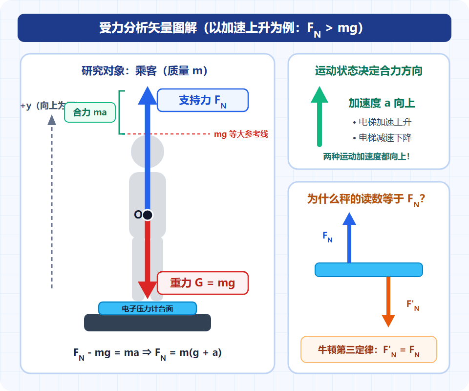

<!-- cs:theme=physics -->
<!-- 主题色 #1e5bb8 -->
<!-- 版式：封面 -->
# 超重与失重

高一物理 · 人教版必修第一册 第四章第 6 节

一节搞懂：电梯里的体重秤为什么会“说谎”？

---

<!-- 版式：情境 -->
## 电梯里的体重秤

> 从 1 楼按到 10 楼：电梯刚启动、匀速上升、快到站停下时，脚下体重秤的读数一样吗？

启动瞬间读数突然变大，匀速时回到原重，快停下时反而变小。

难道坐一趟电梯，人的质量或地球引力变了吗？

---

<!-- 分步 -->
## 本节课我们要搞懂三件事

- 分清「实重」与「视重」：搞清体重秤测量的到底是什么力
- 掌握超重与失重的动力学本质：用牛顿第二定律推导定量公式
- 彻底破除直觉误区：学会只看加速度方向，秒判四类升降运动
- 理解完全失重现象：解释过山车、竖直上抛与空间站水球背后的原理

---

<!-- 分步 -->
## 实重与视重：秤测的到底是什么？

- **实重（真实重力）**：地球吸引产生，大小恒定不变，跟怎么运动无关
- **视重（测力计示数）**：物体对支持物的压力，或对悬挂物的拉力
- 站在秤上时，秤直接感受到的是「脚踩秤面的压力」，而不是人的重力
- 由牛顿第三定律，人对秤的压力与秤对人的支持力总是等大反向

$$G = mg \quad (\text{实重不变}) \qquad F'_{\text{压}} = F_N \quad (\text{视重看支持力})$$

---

<!-- 版式：图解 -->
<!-- 分步 -->
## 受力分析：加速上升为什么会超重？

- 选乘客为研究对象：竖直方向只受支持力与重力
- 加速上升时加速度向上，取竖直向上为正方向
- 由牛顿第二定律，向上的支持力必须大于向下的重力
- 支持力变大，脚对秤的压力随之变大，示数超过实重

$$F_N - mg = ma \implies F_N = m(g + a) > mg$$

---

<!-- 分步 -->
## 反向追问：什么时候示数会比重力小？

- 电梯快到 10 楼**减速上升**，或刚从 10 楼**加速下降**时，加速度竖直向下
- 取竖直向下为正方向，重力大于支持力才能提供向下的合力
- 此时体重秤对人的支持力小于真实重力，秤的读数变小，称为**失重**

$$mg - F_N = ma \implies F_N = m(g - a) < mg$$

> 注意：无论是超重还是失重，物体的真实重力始终等于 $mg$，一丝一毫都没变！

---

<!-- 版式：对比 -->
## 超重与失重 · 核心对照

### 超重状态

- 加速度方向：**竖直向上**
- 合力方向：竖直向上，支持力大于重力
- 对应运动：**加速上升** 或 **减速下降**
- 定量关系：

$$F_N = m(g + a) > mg$$

### 失重状态

- 加速度方向：**竖直向下**
- 合力方向：竖直向下，支持力小于重力
- 对应运动：**加速下降** 或 **减速上升**
- 定量关系：

$$F_N = m(g - a) < mg$$

---

<!-- 版式：情境 -->
## 太空课堂：完全失重时重力消失了吗？

> 空间站里航天员和晶莹水球飘在空中，台秤示数为零，是因为不受地球引力了吗？

当物体向下的加速度大小恰好等于重力加速度时，接触面不再需要提供任何支持力，称为**完全失重**。

地球引力一点没少，只是全部用来提供绕地球圆周运动的向心加速度！

$$a = g \implies F_N = m(g - g) = 0$$

---

<!-- 版式：例题 -->
## 典型例题一：电梯减速下降的示数计算

> 质量为 60 kg 的同学站在电梯内的压力计上。电梯正在向下运动，并以 2 m/s² 的加速度大小匀减速停靠 1 楼，取 g = 10 m/s²，求压力计示数并判断状态。

- 判方向：电梯向下做减速运动，速度向下，但加速度方向**竖直向上**
- 定状态：只要加速度向上，无需算完即可先定性判断处于**超重状态**
- 列方程：以人为研究对象，取竖直向上为正方向，列牛顿第二定律
- 代入求解并换算为压力计示数（牛顿第三定律）：

$$F_N - mg = ma \implies F_N = 60 \times (10 + 2) = 720\,\mathrm{N}$$

---

<!-- 版式：例题 -->
## 典型例题二：从速度图像一眼读出超失重

> 观光电梯从 1 楼直达顶楼，取竖直向上为正方向。其速度随时间变化为：0～2 s 匀加速上升，2～8 s 匀速上升，8～10 s 匀减速上升至停下。逐段判断乘客所处状态。

- 抓关键：速度图像不看正负高低，直接看**图线斜率**（斜率代表加速度）
- 0～2 s 图线斜率为正：加速度竖直向上，乘客处于**超重状态**
- 2～8 s 图线水平斜率为零：加速度为零，支持力等于重力，**既不超重也不失重**
- 8～10 s 图线斜率为负：虽然人还在往上走，但加速度向下，处于**失重状态**

---

<!-- 版式：对比 -->
## 直觉陷阱 vs 物理铁律

### 最易踩坑的直觉误区

- 误区一：只要往上升就是超重，往下降就是失重
- 误区二：超重就是人的体重增加了，失重就是重力变小了
- 误区三：竖直上抛到最高点速度为零，所以既不超重也不失重

### 一锤定音的物理判据

- 铁律一：**只看加速度方向**，与速度方向毫无关系
- 铁律二：**实重永远不变**，变的只是接触面弹力（视重）
- 铁律三：上抛最高点只受重力，加速度仍向下等于 g，处于**完全失重**

---

<!-- 分步 -->
## 随堂快测：三道必考情景当场验真章

1. **竖直上抛**：篮球离手后在空中上升、到达最高点、再下落（不计空气阻力），三个阶段分别处于什么状态？
2. **蹲起实验**：同学站在力传感器上快速「下蹲」到最低点静止：传感器读数是先变大后变小，还是先变小后变大？
3. **托箱乘梯**：质量 50 kg 的人双手托着 5 kg 的书箱，随电梯以 2 m/s² 向上加速（g 取 10 m/s²），脚下体重秤示数是多少？

---

<!-- 版式：总结 -->
<!-- 分步 -->
## 课堂小结 · 四张速记卡

- **判据口诀**：超失重不看速度看加速——加速向上必超重，加速向下必失重
- **物理本质**：地球重力 mg 恒不变，变化的只是支持力或拉力（视重）
- **完全失重**：向下加速度恰好等于 g 时弹力清零，天平、弹簧秤失效或归零
- **解题四步**：选对象画受力 → 判加速度方向 → 取正方向列牛二 → 牛三转示数

---

## 答案：随堂快测解析

- **第 1 题**：**全程完全失重**。篮球离手后只受重力，无论上升、最高点还是下落，加速度始终竖直向下且等于 g。
- **第 2 题**：**先变小、后变大（先失重后超重）**。下蹲前半程向下加速（加速度向下，失重），后半程向下减速停住（加速度向上，超重）。
- **第 3 题**：**660 N**。把人和书箱看作整体，总质量 55 kg，向上加速超重：

$$F_N = (M + m)(g + a) = (50 + 5) \times (10 + 2) = 660\,\mathrm{N}$$
