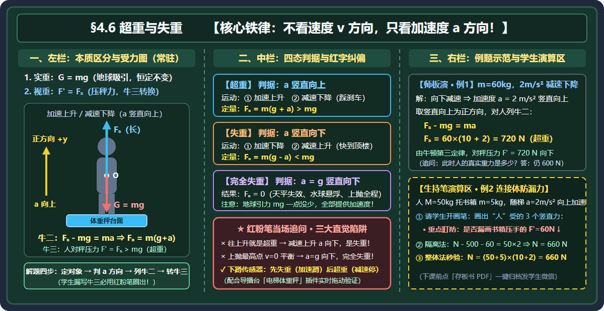

<!-- cs:theme=physics -->
# 超重与失重 · 60 分钟一对一网课逐环节教案

高一物理 · 人教版必修第一册 4.6　　一对一精讲互动课（60 分钟）　　导播台全组件联动示范

| 授课对象 | 教材章节 | 课时与课型 | 本节调用的导播台材料与工具 |
|---|---|---|---|
| 高一学生（一对一） | 人教版必修一 第四章第 6 节 | 60 分钟 · 新授课 | 14 页讲课 PPT、`电梯体重秤` 插件、单文件互动课件、两页导学讲义、课堂黑板 |

## 一、学情诊断与课前准备

- **已有基础**：学生前两节刚学完牛顿第二定律与牛顿第三定律，能对单个物体列 $F_{\text{合}} = ma$，也知道作用力与反作用力等大反向。
- **高频痛点（本节重点盯防）**：① 强烈受生活直觉干扰，极易认为“电梯往上升就是超重、往下降就是失重”；② 容易把体重秤示数变化说成“重力变大或变小”；③ 遇到“人托书箱乘电梯”这类连接体时，隔离分析人常漏掉书箱向下的压力。
- **课前导播台准备**：在导播台预监区提前加载好《超重与失重》讲课 PPT（开启单击分步）、打开「电梯体重秤」小插件待命、备好《互动课件》与《课堂导学讲义》，开启按课表自动录课。

## 二、教学目标与重难点突破

1. **物理观念**：准确区分**实重**（$G=mg$，恒定不变）与**视重**（测力计示数，等于物体对支持物的压力或对悬挂物的拉力），理解完全失重时地球引力并未消失。
2. **科学思维**：能独立完成竖直升降模型的受力分析，通过牛顿第二、第三定律推导出 $F_N = m(g\pm a)$，养成“只看加速度 $a$ 方向判超失重”的严谨习惯。
3. **实验与迁移**：能解释电梯升降、力传感器“下蹲—站起”曲线、竖直上抛及中国空间站水球悬浮现象，掌握连接体“隔离求内力、整体验外力”的双法互验。

- **教学重点**：超重与失重的动力学本质及方向判据（$a$ 向上超重，$a$ 向下失重）。
- **教学难点与突破办法**：破除“向上走必超重”的直觉定势——先让学生口头猜快到 10 楼减速上升时的读数，再**切导播台「电梯体重秤」插件实时减速演示**制造认知冲突，最后让学生在《互动课件》里亲手画 $a$–$t$ 曲线验证。

## 三、60 分钟课堂可视化时间轴

```时间轴
0-5 温故：牛二牛三错题快问与热身
5-13 引入：电梯体重秤悬念与插件盲猜
13-26 推导：区分实重视重，共推 $F_N=m(g\pm a)$
26-38 辨析：破除直觉误区与空间站完全失重
38-52 演练：减速下降与托箱连接体手写实操
52-60 快测：3道点选通关、口诀复盘与布置作业
```

## 四、逐环节教学流程（含提问话术、误区追问与导播台切换）

### 环节 1：温故诊断与铺垫（0–5′ · 5 分钟）

- **导播台操作**：共享学生窗口至「课堂黑板」左栏，开启学生画笔权限。
- **老师提问引入**：“上节课我们练了牛顿第三定律。现在你安静站在平地体重秤上，质量 $50\,\mathrm{kg}$，$g$ 取 $10\,\mathrm{m/s^2}$，秤显示 $500\,\mathrm{N}$——请问这 $500\,\mathrm{N}$ 直接测的是地球拉你的重力，还是你的脚踩秤面的压力？”
- **学生常见直觉误区**：脱口而出“测的就是我的重力呀，大小不都是 $500\,\mathrm{N}$ 吗？”
- **追问纠正话术**：“大小相等不代表是同一个力！地球拉的是你，秤根本没挨着地心，秤面只感受得到谁在踩它？（停顿等学生答：脚的压力）对！静止时脚踩秤的压力碰巧等于重力；那如果电梯突然动起来，这两个力还相等吗？今天我们就揭开体重秤‘说谎’的秘密。”

### 环节 2：生活悬念引入与导播台插件盲猜（5–13′ · 8 分钟）

- **导播台操作**：切至《讲课 PPT》第 2 页（电梯情境图）；第 9 分钟**切出导播台「电梯体重秤」小插件**推上学生屏幕。
- **老师提问引入**：“看图：你站在 1 楼观光电梯的电子秤上按了 10 楼。电梯刚启动往上冲、中间平稳上升、快到 10 楼踩刹车停稳——这三个瞬间，脚下 $500\,\mathrm{N}$ 的读数会怎么变？先凭直觉大胆猜！”
- **学生常见直觉误区**：启动变大、匀速不变都能猜对，但第 3 阶段常猜：“快到 10 楼不是还在往上升吗？应该还是大于 $500\,\mathrm{N}$ 吧！”
- **追问纠正与仿真演示**：“好，记住你猜的‘大于 $500\,\mathrm{N}$’！现在看屏幕上的「电梯体重秤」仿真——我点‘1 楼→10 楼全程运行’，紧盯快到 10 楼减速那两秒的示数！（演示读数瞬间跌到 $400\,\mathrm{N}$）咦？明明人还在往楼上走，秤怎么反而变轻了？问题出在哪个物理量上？”

### 环节 3：受力分析与定量公式推导（13–26′ · 13 分钟）

- **导播台操作**：切至《讲课 PPT》第 4～6 页（单击分步出现），同步在「课堂黑板」左栏画乘客受力矢量图，让学生同步填《课堂导学讲义》第 1 页速查表。
- **老师提问引入**：“别靠感觉猜，让牛顿第二定律说话！把乘客单独拎出来，竖直方向只受哪两个力？刚启动加速上升时加速度 $a$ 朝哪？哪个力必须赢过哪个力？”
- **学生参与与常见误区**：学生能说出受重力 $mg$ 和支持力 $F_N$，列式算出 $F_N = m(g+a)$ 后直接写“所以人对秤压力等于支持力，重力变成了 $m(g+a)$”。
- **追问纠正话术**：“停！两处细节马上抠住：第一，地球和你的质量变没变？没变！所以**实重 $mg$ 永远不变**，变大的只是支持力和压秤的**视重**；第二，$F_N$ 是秤托人的力，秤的读数是人压秤的力，中间必须补哪五个字？（等学生答：牛顿第三定律）漂亮！现在换你口述：快到 10 楼减速上升时，$a$ 朝哪边？方程怎么列？”

### 环节 4：破除三大直觉误区与完全失重探究（26–38′ · 12 分钟）

- **导播台操作**：第 26 分钟切至《讲课 PPT》第 7～8 页（双栏对比 + 空间站水球图）；第 32 分钟**切至单文件《互动课件》仿真页**，让学生口述一条 $a$–$t$ 曲线由老师手画在画布上实时跑电梯。
- **老师提问引入**：“如果电梯钢缆断了（无安全钳理想情况），或者把扎了小孔的漏水矿泉水瓶竖直往上抛，离手后上升、到最高点、再下落——最高点那一瞬间速度是 $0$，水会不会趁机喷出来？”
- **学生常见直觉误区**：“最高点停住了，速度为 $0$，应该既不超重也不失重，水会喷出来！”
- **追问纠正与仿真演示**：“速度等于 $0$，加速度就等于 $0$ 吗？最高点那一刻地球停止吸它了吗？（学生反应：没有，只受重力！）只受重力，那加速度就是竖直向下等于 $g$！来，我们在《互动课件》里点‘完全失重 $a=-g$’预设——你看弹簧秤示数直接归零！只要离手只受重力，上升、最高点、下落**全程完全失重**，水滴和瓶子一起掉，谁也不挤谁，一滴水都不会漏！”

### 环节 5：阶梯例题分步实操与黑板手写查漏（38–52′ · 14 分钟）

- **导播台操作**：切至《讲课 PPT》第 9 页（例题单击分步）配合《导学讲义》第 2 页例 1、例 2；第 44 分钟切回「课堂黑板」右栏虚线区，授权学生用触控笔/鼠标直接画例 2 受力图。
- **老师提问引入**：“先看例 1：$60\,\mathrm{kg}$ 的人以 $2\,\mathrm{m/s^2}$ **减速下降**停靠 1 楼——先别算数字，一秒钟报给我：超重还是失重？（学生答超重，$720\,\mathrm{N}$）稳了！再挑战升级版例 2：$50\,\mathrm{kg}$ 的人双手托着 $5\,\mathrm{kg}$ 的书箱，随电梯以 $2\,\mathrm{m/s^2}$ 向上加速。请你在黑板右栏画出‘人’受的竖直力！”
- **学生常见直觉误区**：学生画了向下的自身重力 $500\,\mathrm{N}$ 和向上的支持力 $F_N$，漏画书箱压手的力；或者补画时随手标成 $50\,\mathrm{N}$，算出 $650\,\mathrm{N}$。
- **追问纠正话术**：“手托着 $5\,\mathrm{kg}$ 的箱子往上加速，手累不累？箱子有没有往下压你的手？（补画箭头）那这个压力是 $50\,\mathrm{N}$ 吗？箱子自己也在以 $2\,\mathrm{m/s^2}$ 超重呀！先隔离箱子算托力是 $60\,\mathrm{N}$，压回来也是 $60\,\mathrm{N}$，合起来 $660\,\mathrm{N}$！再教你一招 3 秒验算：把人和箱子打包成一个 $55\,\mathrm{kg}$ 的整体，$(50+5)\times(10+2)$ 等于多少？（学生惊呼：$660\,\mathrm{N}$！）以后做连接体，**隔离求内力，整体秒验算**，绝不丢分！”

### 环节 6：随堂点选快测、口诀复盘与作业布置（52–60′ · 8 分钟）

- **导播台操作**：切至《互动课件》最后 3 道随堂点选小测（当场点击判分并展开解析）；第 57 分钟切至《讲课 PPT》第 13 页四宫格总结卡，一键保存本节黑板板书 PDF。
- **老师提问引入**：“最后 3 道快测题交给你自己掌舵：1. 力传感器快速‘下蹲’到静止，读数怎么变？2. 空间站里托盘天平和拉簧谁还能用？边选边大声说出加速度方向！”
- **学生常见直觉误区**：下蹲题前半秒容易犹豫“往下用力蹲是不是先超重”。
- **追问纠正与收尾**：“人从静止往下动，第一步速度得从 $0$ 往下长，所以前半段加速向下先失重，快蹲到底刹住车才超重——记住‘**蹲：先失后超；起：先超后失**’！今天这节课用十四个字收官：**超失重看加速，上超下失实重固**。课后完成《分层作业》必做 6 题（30 分钟），计算题照黑板右栏格式先标正方向再列牛二，做完拍照发微信！”

## 五、黑板三栏板书布局设计

### 1. 板书逻辑结构树

```结构图
§4.6 超重与失重（板书总览）
  左栏：本质与受力图解
    实重 $G=mg$ 恒不变，视重 $F'=F_N$
    四步法：对象→判 $a$→牛二→牛三
  中栏：四态判据与红字避坑
    超重 $a\uparrow$：加速升 / 减速降
    失重 $a\downarrow$：加速降 / 减速升
    完全失重 $a=g\downarrow$：$F_N=0$
  右栏：典例示范与生演算区
    例 1 减速下降：$F_N=720\,\mathrm{N}$
    例 2 托箱互验：隔离+整体 $660\,\mathrm{N}$
```

### 2. 16:9 课堂黑板完整三栏布局示意图



## 六、课后练习衔接与弹性应变预案

- **课后巩固衔接**：当堂导出本节板书 PDF 连同《超重与失重-学生长图.png》（必做 6 题 30 分钟 + 家长配合说明）发至微信群；开启导播台课后学情精析，自动记录学生在“减速上升”“托箱漏力”两处的独立掌握度。
- **应变预案 A（学生领悟快，第 46 分钟即提前通关例 2）**：调出《分层练习》第 10 题（托盘以 $12\,\mathrm{m/s^2}$ 向下加速时物块脱离接触的临界问题），引导思考“算出负支持力 $N=-0.40\,\mathrm{N}$ 意味着什么物理图景”，把思维拔高至竞赛/培优水准。
- **应变预案 B（学生正负号与减速方向反复绕晕，环节 3 超时 5 分钟）**：果断延后连接体例 2 至下节课开头，在环节 4 多留 5 分钟用导播台「电梯体重秤」插件带学生慢放对比“加速上升 vs 减速上升”“加速下降 vs 减速下降”四组箭头，确保本节底线目标（单体四态判据 + 定量列式）100% 扎实落地。
